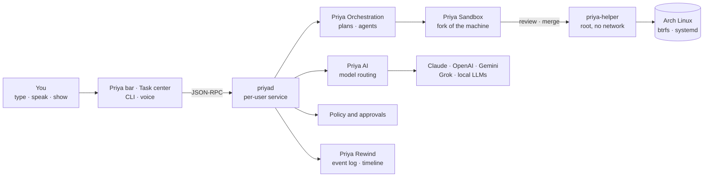

<div align="center">

# PriyaOS

**An open-source, AI-native operating system built on Arch Linux.**

Tell your computer what you want by typing, speaking or showing it. Priya plans the work, picks the best AI for each step, does it on a safe copy of your machine, and lets you review, keep or undo every change.


[Vision](VISION.md) · [Features](#features) · [See the prototype](#see-it) · [Roadmap](#roadmap) · [Tech stack](#tech-stack) · [Docs](#documentation)

</div>

---

> **Status:** planning is done and building starts with phase 0. Everything below describes what PriyaOS **will** do. Progress is tracked in [the phases](docs/human/05-the-phases.md).

## What is PriyaOS?

Today's computers are designed for you to do the work. AI is bolted on as a chat window or one company's assistant. PriyaOS turns this around: **the AI is part of the operating system**, and you stay in charge.

```text
You:    "Set up Docker for my api project and make it start on boot."
Priya:  Here's the plan (4 steps). It runs on a safe copy of your system.
        It needs one approval: adding you to the docker group.  [Approve]
        ...
        Done. 3 packages, 1 service, 2 files changed.  [Review]  [Keep]  [Undo]
```

PriyaOS isn't a new kernel. It's a layer on top of Arch Linux: a background service, a desktop, and a set of tools. You can install it as an app on your existing Arch, or as a full OS next to Windows.

### What makes it different

| | Typical "AI PC" | PriyaOS |
|---|---|---|
| Which AI? | One vendor's model | **Every model you enable** (Claude, OpenAI, Gemini, Grok, local LLMs), with the best one picked for each job |
| Agents | One assistant | **Any agent** (Claude Code, Codex, Gemini CLI, OpenCode, Priya's own), working as a team |
| Safety | "Are you sure?" pop-ups | Work runs on a **copy-on-write fork of the whole machine**. You review a diff, then merge or discard |
| Mistakes | Hope you have a backup | **Undo any single change**, even by describing it: "undo whatever broke my Wi-Fi on Tuesday" |
| Your data | In someone's cloud | **Local-first**, inspectable memory; you choose what leaves the device |
| Openness | Closed | **Open source**, neutral between AI companies, extensible with modules |

## Features

Five flagship features carry the Priya name. All 275 planned features, each with an ID and a phase, are listed in the [feature catalog](docs/claude/features.md). A plain-language version is [here](docs/human/04-everything-priyaos-will-do.md).

### 🧠 Priya AI: one AI over every model
- Works with **Anthropic, OpenAI, Google, xAI** and any **OpenAI- or Anthropic-compatible** endpoint (Ollama, LM Studio, llama.cpp, vLLM, OpenRouter).
- **Routes each job to the best model**, both within a family (Haiku → Sonnet → Opus → Fable) and across families.
- **Strategies**: best, balanced, cheapest, local-only, one family, or a fixed model. Switch with a click or in plain words.
- **Token optimizer**: cache-aware prompts, compaction, trimming and output caps. Costs shown live, including in ₹.
- **Local LLMs are first-class**, with offline fallback and privacy routing that controls which data goes to which provider.
- Add a new model with one settings entry, no code. A local proxy lets other tools use Priya's routing too.
- Learns from outcomes which model actually works best for each kind of job.

### 🤝 Priya Orchestration: a team of AI agents
- Breaks big jobs into a **plan you can see and edit** before anything runs.
- Runs **Claude Code, Codex, Gemini CLI, OpenCode** and Priya's native agent, in parallel where possible. Grok Build, Aider, Goose and others follow later.
- **Cross-family checking**: work from one AI family is reviewed by another.
- Shared notes between agents, conflict handling, and jobs that survive restarts.
- Covers the whole software workflow: issues → branches → code → tests → pull requests.

### 🛡️ Priya Sandbox: try everything on a copy
- An **instant copy-on-write fork of the whole machine**: packages, services, system files and your home folder.
- A **machine-wide diff** to review, then **merge or discard**, with three-way merging when you and an agent changed the same file.
- **Execution modes, chosen per task and per feature**: read-only, sandbox, or direct with a safety snapshot.
- System changes apply on reboot, with rollback (including the kernel) and a "boot the previous system" menu entry.

### ⏪ Priya Rewind: undo anything
- A **timeline of every change** made by agents, settings or you.
- **Undo one change** and keep everything after it, or return the whole system to a point in time.
- **Undo by describing the problem**: Priya finds the likely cause and explains it before acting.
- Understands packages, so it rolls back an upgrade properly instead of just restoring files.

### 👁️ Priya Vision: it can see what you see
- Ask about **your screen, a window, a region or an image**: "what's this error?", "fill this form from that PDF".
- Local text recognition when the chosen model can't read images.
- Only looks when you ask, and shows exactly what it captured.

### And everything else an OS needs
| Area | Highlights |
|---|---|
| 🎙️ **Voice** | Push-to-talk (Super+V) or "Hey Priya", local speech recognition, English and Hindi |
| 🖥️ **Desktop** | The Priya bar (Super+Space), Task center, agent workspace, notifications with actions, settings by talking ("only use local models for my Documents folder") |
| 🎨 **Design** | Light, dark, OLED black, high contrast and auto themes; accent colours; one design system across the bar, apps, terminal, login and boot screens |
| 🔐 **Security** | Approval levels you choose ("Ask me first / Ask when it matters / Just do it"), Cedar policies, Landlock, secrets kept out of prompts, taint tracking so untrusted text can't trigger dangerous actions, a full audit log, and a kill switch (Super+Shift+Esc) |
| 🛠️ **System care** | Safe updates, problem finding and fixing (`priya doctor`), a health page |
| 🗂️ **Memory and tools** | Project memory, your preferences, find files by describing them; every installed program becomes a tool |
| ⏰ **Automation** | Scheduled jobs, morning summary, overnight tidy-up, teach-by-showing |
| 📱 **Devices and teams** | Approve from your phone, continue on another computer, share with teammates |
| 🧩 **Ecosystem** | Modules (plugins) with a versioned API, an add-on store, custom mini-apps, themes from your wallpaper |
| 💿 **Base OS** | Arch Linux with a signed `[priyaos]` package repo, btrfs layout, a guided installer that keeps Windows safe |

## See it

A clickable prototype of the PriyaOS desktop (dark theme) shows the Priya bar, plan preview, approvals, Task center, agent workspace, Rewind and Settings.

➡️ **[ui/mockups/prototype/priyaos-live.html](ui/mockups/prototype/priyaos-live.html)**: download it and open it in any browser. Details are in [ui/mockups](ui/mockups/README.md) and [How it looks and feels](docs/human/09-how-it-looks.md).

## How it works



- **`priyad`** is the brain. It runs as you (not root) and keeps every action in a tamper-evident event log.
- **`priya-helper`** is the only part that runs as root. It has no network access and can do only a small, fixed set of operations.
- **Modules** add features without touching the core. Every outside dependency sits behind a tested interface, so models, agents and tools can be swapped.
- Everything in the UI can also be done from the `priya` command line.

The full design is in the [system overview](docs/claude/architecture/01-system-overview.md) and the [design principles](docs/claude/architecture/00-principles.md).

## Tech stack

| Layer | Technology |
|---|---|
| Core, daemon, CLI, installer | **Rust** (Cargo workspace) |
| Desktop UI | **QML** on **Quickshell**, running on the **Hyprland** Wayland compositor |
| Base OS | **Arch Linux**, pacman with our own signed repo, archiso for the ISO, systemd, GRUB |
| Filesystem and sandbox | **btrfs** subvolumes and snapshots, systemd-nspawn / bubblewrap, Landlock |
| Data | **SQLite** (WAL), hash-chained event store |
| API | **JSON-RPC** over a local socket; modules speak JSON-RPC over stdio |
| Config and data formats | **TOML** (manifests, model catalog, recipes), **JSON Schema** (settings), **Fluent** (translations) |
| Security policies | **Cedar** |
| Voice and vision | **whisper.cpp** (speech to text), **Piper** (text to speech), grim + tesseract (screen and OCR) |
| Low-level tracing (later) | **eBPF** |
| CI | **GitHub Actions**, plus a self-hosted runner on the test laptop and QEMU VMs |

## Roadmap

PriyaOS is built in **17 phases**, split into 222 small sub-phases. Each sub-phase is planned, built and tested before the next one starts, and it's usable from phase 0.

| # | Phase | What you can do at the end |
|---|---|---|
| 0 | Foundations | Press Super+Space on any Arch, ask, get an answer. CI is running |
| 1 | **Priya AI** | Use all your AI accounts and local models; Priya picks the best; see costs |
| 2 | **Priya Sandbox** | Run anything on a safe copy, review, keep or discard; early installer |
| 3 | Tasks and safety | Live job status, approvals, autonomy levels, hidden secrets, kill switch |
| 4 | Agents | "Do this" → plan → the best agent does it → review → keep |
| 5 | Desktop | The complete desktop: top bar, notifications, settings by talking, themes |
| 6 | System care | Safe updates, problem finding and fixing, health page |
| 7 | **Priya Rewind** | Undo anything, even by describing what went wrong |
| 8 | Memory and tools | Project memory, preferences, find files by describing them |
| 9 | **PriyaOS 1.0** | Polished installer, all normal OS settings, branded boot and login |
| 10 | Voice | Talk to Priya in English or Hindi |
| 11 | **Priya Vision** | Priya understands your screen and images |
| 12 | Orchestration v2 | Many agents on one big job, checking each other, through to PRs |
| 13 | Automation | Scheduled jobs, morning summary, teach-by-showing |
| 14 | Advanced security | Per-job internet limits, plain-language rules, signed add-ons, Secure Boot |
| 15 | Devices and teams | Approve from your phone, continue elsewhere, share with teammates |
| 16 | Ecosystem | Add-on store, mini-apps, self-restyling desktop |

Detailed plans: [phase workflow and sub-phase map](docs/claude/phases/README.md) · [plain-language version](docs/human/05-the-phases.md).

## Repository layout

```text
PriyaOS/
├── VISION.md            Why PriyaOS exists and where it's going
├── CLAUDE.md            Working rules for AI coding agents in this repo
├── docs/
│   ├── claude/          Technical specs: architecture, ADRs, features, phase plans
│   └── human/           Plain-language guides for everyone
├── scripts/             Machine survey, dev setup and checks, script tests
├── ui/
│   └── mockups/         Clickable prototype and design screens
│
│   Added as building starts:
├── crates/              Rust workspace (priyad, priya-cli, priya-ai, priya-sandbox, …)
├── modules/             First-party modules (plugins)
├── xtask/               Developer commands (test suites, coverage, schemas)
├── ui/design/           Design tokens (colours, type, spacing)
├── ui/PriyaUI/          Shared QML component library, plus a gallery
├── ui/shell/, ui/apps/  The Quickshell desktop: Priya bar, top bar, Task center, Settings
├── packaging/           pacman packages, systemd units, the ISO profile
└── .github/workflows/   CI
```

## Develop

| Machine | One-time setup |
|---|---|
| Arch Linux (builds, UI, system tests) | `bash scripts/dev-setup-arch.sh` |
| macOS (docs, portable Rust crates) | `bash scripts/dev-setup-macos.sh` |

Both scripts show what they'll install and ask first. Afterwards:

- `bash scripts/dev-check.sh` checks every needed tool is there.
- `bash scripts/tests/run.sh` runs the script tests.
- `bash scripts/survey.sh > survey.md` describes a machine (read-only; personal details masked).

Specs live in [docs/claude](docs/claude/README.md) and guides in [docs/human](docs/human/README.md). AI coding agents follow [CLAUDE.md](CLAUDE.md).

## Documentation

**Start here**
- [VISION.md](VISION.md): the idea, the market and what sets PriyaOS apart
- [What is PriyaOS?](docs/human/01-what-is-priyaos.md): the short, simple version
- [How it looks and feels](docs/human/09-how-it-looks.md)

**Plain-language guides** ([index](docs/human/README.md))
- [How it works](docs/human/02-how-it-works.md) · [Priya AI](docs/human/03-priya-ai.md) · [Everything it will do](docs/human/04-everything-priyaos-will-do.md)
- [The phases](docs/human/05-the-phases.md) · [How we test](docs/human/06-how-we-test.md) · [Installing on a laptop](docs/human/07-install-on-your-zenbook.md) · [Words explained](docs/human/08-words-explained.md)

**Technical specs** ([index](docs/claude/README.md))
- [Principles](docs/claude/architecture/00-principles.md) · [System overview](docs/claude/architecture/01-system-overview.md) · [Core](docs/claude/architecture/02-core.md)
- [Execution and sandbox](docs/claude/architecture/03-execution-and-sandbox.md) · [Priya AI](docs/claude/architecture/04-priya-ai.md) · [Security](docs/claude/architecture/05-security.md) · [Orchestration](docs/claude/architecture/06-orchestration.md)
- [Interfaces](docs/claude/architecture/07-interfaces.md) · [Rewind, memory and tools](docs/claude/architecture/08-rewind-memory-tools.md) · [Testing and CI](docs/claude/architecture/09-testing.md)
- [Base OS and distro](docs/claude/architecture/10-base-os-and-distro.md) · [Design system and UX](docs/claude/architecture/11-design-system-and-ux.md) · [Automation, devices, ecosystem](docs/claude/architecture/12-automation-devices-ecosystem.md)
- [Architecture decisions (ADRs)](docs/claude/architecture/decisions.md) · [Feature catalog](docs/claude/features.md)

## How we build it

- **Small steps, always tested.** Every sub-phase is planned → built → tested → gated. Tests come with the code, and finished features join a permanent regression suite.
- **CI on every push** runs unit, contract, integration and UI screenshot tests. Nightly runs add full VM installs, performance and security checks. See [Testing and CI](docs/claude/architecture/09-testing.md).
- **Pull requests only**, kept small, with coverage and feature-traceability checks.
- **Safety first.** Destructive system operations are only ever tested in a fake machine image or a VM, never on a real disk.
- **The UI matters as much as the backend.** There's one design system, every state is designed, every theme is tested, and keyboard and screen-reader access are built in.

## Contributing

PriyaOS is open source and still at the planning stage, so this is a great time to shape it. Ideas, issues and feedback on the [vision](VISION.md) and [architecture](docs/claude/README.md) are welcome. Code contributions open up with phase 0. Proposed features go into the [feature catalog](docs/claude/features.md) with an ID and a phase.

## License

PriyaOS is licensed under the [Apache License 2.0](LICENSE). You may use, change and share it, including commercially, as long as you keep the licence and [NOTICE](NOTICE). Outside components are listed in [THIRD_PARTY.md](THIRD_PARTY.md).
